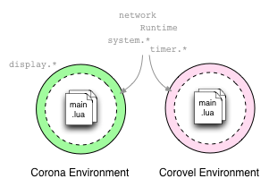

# Lua Corovel

Runs non-visual Solar2D (Corona SDK) code in plain Lua 5.1, outside the Simulator.

Corovel provides a small copy of Solar2D's runtime: an event loop that sends `enterFrame` events, plus `Runtime`, `timer`, `system` and `network`. Code written for Solar2D that only uses those, such as [dmc-sockets](https://github.com/dmccuskey/dmc-sockets), [dmc-websockets](https://github.com/dmccuskey/dmc-websockets) and [dmc-wamp](https://github.com/dmccuskey/dmc-wamp), runs unmodified from a terminal: in tests, in CI, or on a server. Corovel has no `display`, graphics or physics.



```sh
lua5.1 corovel.lua main      # loads ./main.lua and runs the event loop
```

## Features

- An event loop with `enterFrame` events (10 per second by default, configurable).
- `timer.performWithDelay()` and `timer.cancel()`, with repeat counts.
- `Runtime:addEventListener()`, `removeEventListener()`, `dispatchEvent()`, with function or table listeners.
- `system.getTimer()`, `system.pathForFile()` and the directory constants.
- `network.request()` over HTTP and HTTPS (blocking; see [Reference](docs/reference.md#network)).
- A `plugin.openssl` stand-in, so libraries that use Solar2D's OpenSSL plugin get LuaSec instead.
- A `json` module that wraps whichever JSON library is installed (`dkjson` or `cjson`).
- Runs until the loaded module says it's done, or forever for a server.

## Quick Start

This runs a small Solar2D-style program with timers and `enterFrame` events in about 5 minutes, in a terminal on macOS or Linux. You need Lua 5.1 with LuaSocket, LuaFileSystem and LuaSec (check: `lua5.1 -e "require 'socket'; require 'lfs'; require 'ssl'"` prints nothing), and a JSON library, `dkjson` or `cjson`, for the tests. With LuaRocks: `luarocks install luasocket luafilesystem luasec dkjson`.

### 1. Get the code

```sh
git clone https://github.com/dmccuskey/lua-corovel.git
cd lua-corovel
```

### 2. Run the example

Corovel's own modules are in `corovel/`, so it goes on `LUA_PATH` (the trailing `;;` keeps the default path):

```sh
cd examples/corovel-timers
LUA_PATH="./?.lua;../../?.lua;../../corovel/?.lua;;" lua5.1 ../../corovel.lua main
```

It prints three ticks and the number of `enterFrame` events it saw, then exits after two seconds:

```text
started at	0.35
tick	624
tick	1252
tick	1876
frames seen:	18
```

`module 'event_loop' not found` means `corovel/` isn't on `LUA_PATH`.

### 3. Write your own

`main.lua` in the example is an ordinary Solar2D-style module: it uses the globals `Runtime`, `timer` and `system`. It returns a table with an `execute()` method, which Corovel calls once, and an `is_working` flag; Corovel runs until the flag is `false`. A module that returns nothing runs forever, like a server.

**Going further:** how Corovel loads a module, the settings in `corovel_cfg.lua`, and what each Solar2D API supports: [Reference](docs/reference.md).

## Documentation

- [Reference](docs/reference.md): running a module, configuration, the Solar2D APIs provided, Known Issues.
- [Development](docs/development.md): the tests.
- [Examples](examples/): `corovel-timers` runs; the two TCP examples are from 2015 and don't.

## Why Corovel?

The name comes from *Corona Event Loop*. It was written in 2014 so the DMC networking libraries (sockets, WebSockets, WAMP) could run on a server without rewriting them: Solar2D's async code is built on two things, `Runtime`, which sends an event every frame, and `timer`, and both need only an event loop. dmc-websockets' [Autobahn test harness](https://github.com/dmccuskey/dmc-websockets/tree/master/tests/autobahn) runs the library under Corovel today.

An earlier version of this README described running Corovels in separate OS threads with [Lua Lanes](https://github.com/LuaLanes/lanes). That was never implemented.

## License

MIT; see [LICENSE](LICENSE).
